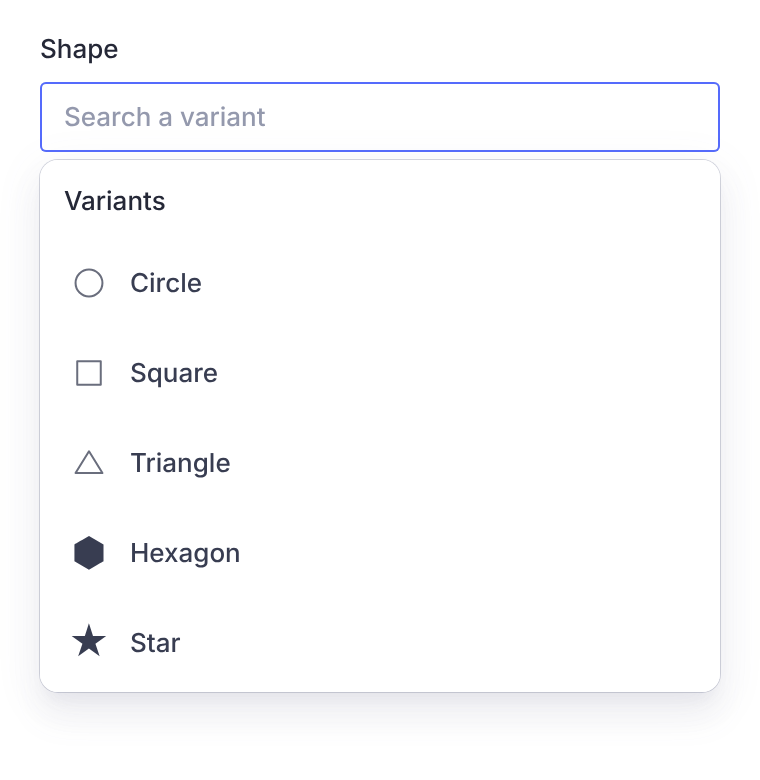
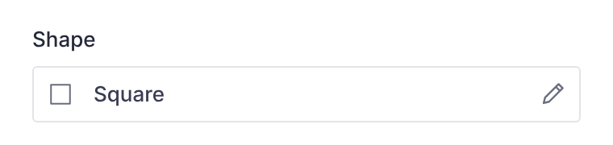

# sanity-plugin-variant-picker

A Sanity Studio `string` field built like a link picker: one input and a popover that searches the field's `options.list`. Forked from [sanity-plugin-color-select](https://github.com/dennisregalado/sanity-plugin-color-select).

<p>
  
  
</p>

- **Native options**: reads `options.list` exactly like a `string` field, so `{title, value}` items and plain strings both work.
- **Icons**: give an item an `icon` and it shows on the left, in the list and on the picked value.
- **Search**: type to filter by title or value; Enter picks the first match.
- **Picked value**: shown as a native preview row with a pencil on the right that clears it and reopens the search, like sanity-plugin-color-select.
- **A plain string value**: stores the picked item's `value`, the same as a native string select.
- **Existing fields too**: `stringLists: true` puts the picker on every `string` field with an `options.list`, with no schema changes.

## Install

```sh
npm install sanity-plugin-variant-picker
```

**Requirements:** Sanity Studio 6. `@sanity/ui` (v4) and `@sanity/icons` (v5) are peer dependencies, and `sanity` already installs them, so there's nothing else to add. The plugin uses your Studio's copy.

```ts
// sanity.config.ts
import {defineConfig} from 'sanity'
import {variantPicker} from 'sanity-plugin-variant-picker'

export default defineConfig({
  // ...
  plugins: [variantPicker()],
})
```

## Usage

```ts
import {defineField} from 'sanity'
import MoonIcon from '@sanity/icons/Moon'
import SunIcon from '@sanity/icons/Sun'

defineField({
  name: 'size',
  title: 'Size',
  type: 'variantPicker',
  options: {
    list: [
      {title: 'Small', value: 'sm', icon: SunIcon},
      {title: 'Medium', value: 'md', icon: MoonIcon},
      'large', // shown as "Large", stored as "large"
    ],
  },
})
```

`icon` takes a component (e.g. from `@sanity/icons`), an element, or an emoji string. Items without a `value` are skipped.

### Placeholder

Set it with `options.placeholder` (default "Search a variant"), not the field's `placeholder`:

```ts
defineField({
  name: 'size',
  type: 'variantPicker',
  options: {list: ['small', 'large'], placeholder: 'Pick a size'},
})
```

Why `options`: Sanity drops a field-level `placeholder` on types that extend `string` (such as `variantPicker`); only `options` and a few other keys carry over to the field. A `placeholder` set directly on a plain `string` field still works as a fallback.

## Existing string fields

To use the picker on the `string` fields you already have, turn on `stringLists`:

```ts
plugins: [variantPicker({stringLists: true})]
```

Every `string` field with a non-empty `options.list` then gets the picker, with no schema changes. The field keeps `type: 'string'`, so `sanity typegen` still generates its literal union (`'sm' | 'md'`). With `type: 'variantPicker'` it generates `string`. Stored values don't change.

It skips:

- **Radio groups** (`options.layout: 'radio'`): every option is visible and one click away, so they stay native. Set `layout: 'dropdown'` (or drop `layout`) to switch one over.
- **Fields with their own input** (`components.input`, on the field or on a type it extends): those always win.

For a single field instead, keep `type: 'string'` and set the input yourself:

```ts
import {VariantPickerInput} from 'sanity-plugin-variant-picker'

defineField({
  name: 'size',
  type: 'string',
  options: {list: ['small', 'large']},
  components: {input: VariantPickerInput},
})
```

## Stored value

The picked item's `value`, as a string:

```groq
*[_type == "product"][0]{size}
// {"size": "sm"}
```

The pencil unsets the value; leaving the field without picking keeps it empty.

## Development

```sh
bun install
npm run lint && npm run typecheck && npm test && npm run build
```

Component tests (`src/*.test.tsx`) run in jsdom with Testing Library. To re-render the screenshots above into `docs/` (needs Playwright with Chromium installed globally): `npm run docs:screenshots`.

## Releasing

Releases are published to npm by GitHub Actions ([`publish.yml`](.github/workflows/publish.yml)); nobody runs `npm publish` locally. (0.1.0, the first release, was published by hand: npm trusted publishing can only be set up once a package exists.)

1. Bump `version` in `package.json` in your PR.
2. Merge it to `master`. The workflow runs lint, typecheck, tests and build, publishes that version to npm with provenance, then tags `v<version>` and creates a GitHub release. Prerelease versions (e.g. `1.0.0-beta.1`) publish under the `next` dist-tag.

Merges that don't change the version publish nothing. To retry a failed publish, run the workflow from the Actions tab.

## License

MIT © Dennis Regalado
